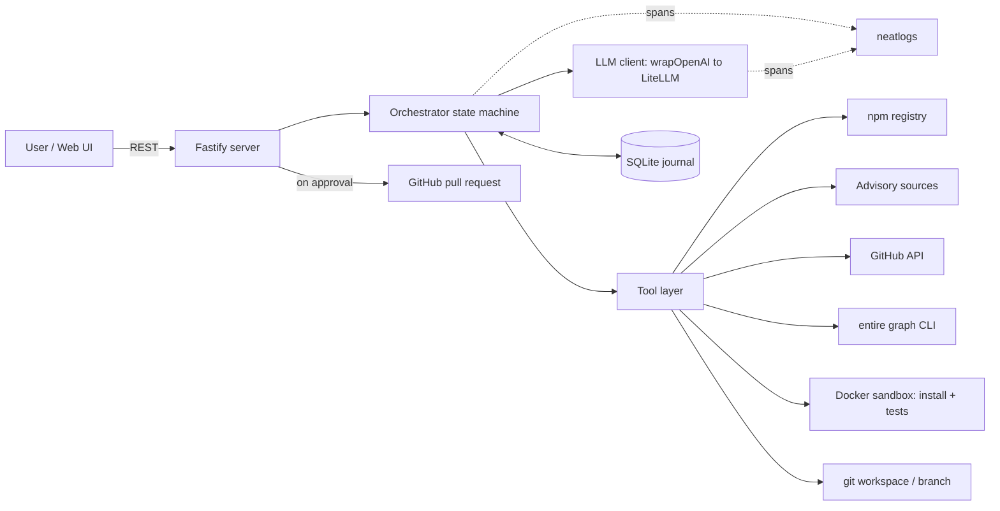
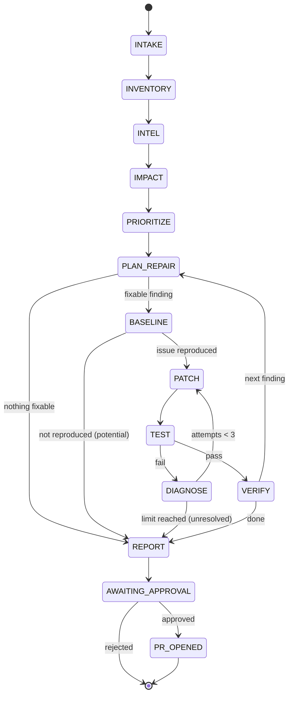

# VERITAS_PLAN.md

**Veritas: Verified changes. Reliable software.**
Planning document for neatHack (Oct 10–12, 2026). This file is the first commit after Entire is enabled.

**Labels used throughout**
- **[Verified]**: read from the official source on Oct 10, 2026.
- **[To verify]**: believed true, must be confirmed in Milestone 0 before code depends on it.
- **[Assumption]**: our own choice or estimate.

**Decisions already made by the owner:** full build as specified (all six views) and this full 31-section plan.

---

## 1. Executive summary

Veritas is an autonomous agent for JavaScript/TypeScript repositories. Given a repo, it finds dependency changes that matter, proves whether each one affects that repo's code, writes a minimal fix in an isolated workspace, recovers when the fix fails its tests, verifies the result, and reports with evidence. Nothing touches the original repo until a human approves; approval opens a pull request.

It is built for neatHack's single track ("an agent that completes a substantial task from start to finish") and gives each required sponsor tool a role at both build time and run time:

| Tool | Build-time role | Run-time role |
|---|---|---|
| neatlogs | Find a real problem in a trace, fix it, compare runs | Every model call, tool call, retry and failure is traced |
| Entire | Checkpoints for every commit; entire-graph gives the coding agent repo context | Veritas calls `entire graph` commands for impact analysis |
| cfo.ai | Business plan: pricing, costs, revenue, runway | Measured cost per investigation (from neatlogs) is the plan's unit cost |

Solo build, one EC2 instance, $20 model budget, deadline Oct 12, 11:55 PM IST (planned).

## 2. Problem statement

Dependency tools tell teams *that* something changed. They rarely say whether the change breaks *this* repository, and they do not prove a fix works. Engineers then spend time on four questions Veritas answers with evidence:

1. What changed in the dependency?
2. Does it affect this repository?
3. What is the safest reasonable fix?
4. Can we prove the fix works?

Every finding is labelled **confirmed**, **potential**, or **unresolved**. An outdated package is never called a vulnerability unless a published advisory says so.

## 3. Target users and personas [Assumption]

| Persona | Situation | What they want from Veritas |
|---|---|---|
| Solo maintainer of an npm-based product | Ignores upgrade alerts because triage is slow | "Tell me which three of these 40 alerts actually break me, with a tested patch." |
| Tech lead, 5–30 engineers | Upgrade backlog grows; major bumps get postponed for quarters | Reviewable PRs with proof, so upgrades become routine review work |
| Platform / security engineer | Must clear advisories across many repos | Per-repo evidence of real exposure, to prioritise |

## 4. Positioning and differentiation

Dependabot, Renovate and Snyk are the known tools in this space. Based on their public positioning they open version-bump PRs and raise alerts; Veritas's claim is narrower and checkable:

- **Impact proof:** names the files and symbols in *your* repo that use the changed API.
- **Verified repair:** a patch is reported as fixed only when the reproducing test fails before and passes after, with no new failures.
- **Honest outcomes:** "not affected" and "unresolved" are first-class results.

This is the originality argument for judging (10%). The pitch and video lead with "proof, not alerts".

## 5. Core user journey

1. **Intake:** user gives a GitHub URL (or uploads a zip). Veritas clones into an isolated workspace.
2. **Inventory:** reads `package.json` and `package-lock.json`; lists direct and transitive dependencies, installed and latest versions, deprecations.
3. **Intelligence:** fetches registry metadata, release notes and advisories; stores each source with URL and retrieval time.
4. **Impact analysis:** finds imports and call sites of the affected package; explains why the change matters here.
5. **Prioritisation:** scores findings with a documented formula (section 14).
6. **Repair planning:** proposes the smallest fix, or "leave unresolved".
7. **Isolated patching:** applies the change on a branch in the workspace and runs tests.
8. **Recovery:** on failure, reads the test output, revises, retries within limits.
9. **Verification:** compares before and after.
10. **Report and approval:** user inspects the report and diff; "Approve" opens a pull request.

## 6. Functional requirements

| ID | Requirement | Focus area |
|---|---|---|
| F1 | Clone a public GitHub repo or accept a zip upload | Tool use |
| F2 | Build dependency inventory from manifest and lockfile | Tool use |
| F3 | Fetch registry metadata, releases, advisories; record sources | Tool use, Context |
| F4 | Produce a per-finding investigation plan and revise it as evidence arrives | Planning, Iteration |
| F5 | Locate usage of an affected package (files, symbols, tests) | Context |
| F6 | Score and rank findings with a testable formula | Planning |
| F7 | Generate a patch on an isolated branch | Execution |
| F8 | Run install and tests in a sandbox | Tool use, Verification |
| F9 | On failure, diagnose from real output and retry, max 3 attempts | Recovery, Iteration |
| F10 | Journal every step; a killed run resumes without repeating finished steps | State |
| F11 | Verify: reproduced before, passes after, no regressions | Verification |
| F12 | Report with sources, diff, test logs, attempts, remaining risk | Verification |
| F13 | Human approval gate, then open a PR | Safety |
| F14 | Trace every run in neatlogs | Required tool |
| F15 | Six UI views (section 23) | Demo |

## 7. Non-goals and MVP boundaries

- JavaScript/TypeScript with npm only. No yarn, pnpm, monorepos, or other languages.
- Not a full security scanner. Advisories come from published databases only.
- No auto-merge, ever. No writes to the default branch.
- Private repos, auth, multi-user and billing are out.
- Zip upload is the first thing cut if time runs short (git URL covers the demo).

## 8. Technology choices

| Area | Choice | Why |
|---|---|---|
| Language | TypeScript on Node.js 22+ (v24 on the dev machine) | One language for agent, server and UI. [Verified in M0] Node 22+ can `require()` ES modules, but ESM-only packages still break CommonJS callers: `require('chalk')` returns a namespace object and `chalk.red` is not a function. Node 20 fails earlier with `ERR_REQUIRE_ESM`. Each benchmark case records the Node version it was reproduced on, and the sandbox runs that version. |
| Model access | `openai` npm client pointed at the hackathon LiteLLM endpoint | Free $20 budget; OpenAI-compatible [Verified]. No Bedrock on the AWS account [Verified]. |
| Models | `claude-haiku` for development, `claude-sonnet-4.6` for scored runs | Protects the $20 cap. IDs [Verified] on the models page. |
| Tracing | `neatlogs` npm package: `init`, `wrapOpenAI`, `span`, `trace`, `flush`, `shutdown` | [Verified] in the TypeScript SDK docs. No auto-instrumentation in TS, so wrappers are explicit. |
| State | SQLite via `better-sqlite3` | No managed database is allowed on the AWS account; single file, zero ops. |
| Server | Fastify | Small, typed, serves the built UI as static files. |
| UI | Vite + React + plain CSS | Fast to build six read-mostly views. |
| Sandbox | Docker on the EC2 instance | Isolation for untrusted repo code. |
| Tests | Vitest for Veritas itself; each target repo's own test command for verification | |
| Code intelligence | `entire graph` CLI, behind an adapter with a fallback | Section 14. |
| Host | One EC2 `t3.large`, us-east-1, inside `Hackathon_VPC`, EBS ≤ 50 GB | All [Verified] limits. One instance only. |

## 9. System architecture

One Node process on one server. The orchestrator is a deterministic state machine; the model makes decisions inside states (planning, impact reasoning, repair) through tool calls. This hybrid is more reliable than a free-running loop and still shows planning and iteration in the trace.

- **Orchestrator** (`src/agent`): drives states, enforces limits, writes the journal.
- **Tools** (`src/tools`): typed functions, each wrapped in a neatlogs `span({ kind: 'TOOL' })`.
- **LLM client** (`src/llm`): the wrapped OpenAI client plus prompts.
- **State store** (`src/state`): SQLite.
- **Sandbox** (`src/tools/sandbox.ts`): Docker runner.
- **Server and UI** (`src/server`, `web/`).
- **Bench** (`bench/`): fixed cases, runner, scorer.

## 10. Architecture diagram



## 11. Agent execution loop and state machine



Rules:
- Each state is a list of **steps**. A step has an idempotency key (`state + finding + input hash`). Before running, the orchestrator checks the journal; a finished step with the same key is skipped and its stored output reused. This is the State and resume mechanism.
- Inside IMPACT, PLAN_REPAIR and DIAGNOSE the model runs a bounded tool-calling loop (max 12 tool calls per step).
- DIAGNOSE receives the real test output and the diff of the previous attempt, and must state what it will change and why. That text is stored and shown in the UI.
- Limits: 3 repair attempts per finding, 5 minutes per sandbox command, 30 minutes per investigation, a per-investigation token ceiling.
- Transient tool errors (HTTP 429/5xx, network) retry with backoff, max 3. Malformed model output is re-requested once with the validation error.

## 12. State persistence and data model

SQLite file at `VERITAS_DB_PATH`. Tables:

| Table | Key columns |
|---|---|
| `investigations` | id, repo_url, commit_sha, status, current_state, started_at, finished_at, neatlogs_trace_ref |
| `steps` | id, investigation_id, state, idem_key, status, input_json, output_json, error, started_at, duration_ms, attempt |
| `dependencies` | investigation_id, name, installed, latest, direct, deprecated |
| `findings` | id, investigation_id, package, kind (breaking / advisory / deprecation), status (confirmed / potential / unresolved / not_affected), severity, confidence, usage_score, priority, rationale |
| `sources` | id, finding_id, url, kind, retrieved_at, excerpt, verified (bool) |
| `affected_sites` | finding_id, file, line, symbol, provider (graph / fallback) |
| `attempts` | id, finding_id, n, plan_text, diff, outcome, diagnosis_text |
| `test_runs` | id, attempt_id (nullable for baseline), command, exit_code, passed, failed, log_path, duration_ms |
| `reports` | investigation_id, markdown, json, verdict |
| `approvals` | investigation_id, decision, decided_at, pr_url |

Large logs are files under the workspace; the table stores paths.

## 13. External APIs and data sources

| Source | Use | Status |
|---|---|---|
| npm registry `https://registry.npmjs.org/<package>` | Versions, `deprecated` field, repository URL | [Verified in M0] |
| `npm outdated --json`, `npm ls --all --json`, `npm audit --json` | Inventory and advisories for the installed tree | [Verified in M0]; `outdated` and `audit` exit 1 when they have findings |
| GitHub REST: releases for a repo | Release notes | [Verified in M0] |
| GitHub Advisory Database (REST global advisories) | Published advisories for npm packages | [Verified in M0]: `GET /advisories?ecosystem=npm&affects=<pkg>@<version>` |
| OSV (`api.osv.dev`) | Second advisory source | [Verified in M0]; optional |
| Package `CHANGELOG.md` from the published tarball or repo | Fallback when releases are empty | [Assumption] |
| LiteLLM `https://litellm.vision.aivar.app/v1` | Models | [Verified] |
| Crustdata | Not used | Optional per rules |

Observed response shapes are in `evidence/m0-verification.md`.

Every stored source records its URL and whether the claim was read from the source (`verified = true`) or inferred by the model (`false`). The report shows them separately.

## 14. Dependency impact-analysis strategy

**Inputs:** the package, the version range crossed, the extracted list of changed or removed APIs from release notes.

**Step A, cheap filter (no model):** search the repo for imports or requires of the package. No usage means `not_affected` immediately.

**Step B, usage map:** an `ImpactProvider` interface with two implementations:
- **`GraphProvider`** shells out to `entire graph`. [Verified in M0] `edges` (NDJSON) lists package usage directly as `IMPORTS` to `external:import:<pkg>` and `CALLS` to `external:symbol:<pkg>.<member>` with file and line; `neighbors --symbol` (JSON) gives callers. `impact --symbol` prints text only, so its output is stored as evidence and not parsed.
- **`FallbackProvider`** uses the TypeScript compiler API to resolve imports and references.

[Verified in M0] JavaScript and TypeScript are supported with import and call relations, and the graph needs no login and no network, so `GraphProvider` is primary and the fallback covers what the graph misses. [To verify in M10: install on the EC2 instance; a `linux_amd64` release asset exists.]

**Step C, reasoning:** the model receives only the changed-API list and the matching call sites (never the whole repo) and returns, per site, "affected / not affected / unsure" with a reason.

**Step D, proof:** a finding becomes `confirmed` only when a test or a generated minimal script fails on the new version. Otherwise it stays `potential`.

**Priority formula** (unit-tested in `tests/prioritize.test.ts`):

`priority = 0.35·severity + 0.30·usage + 0.20·confidence + 0.15·fixAvailable`, each term in 0–1.
- severity: advisory severity (critical 1.0, high 0.75, moderate 0.5, low 0.25); breaking change with confirmed failure 0.75; deprecation 0.25.
- usage: 0 if unused; else scaled by number of affected sites, capped at 1.
- confidence: confirmed 1.0, potential 0.5, unsure 0.25.
- fixAvailable: 1 if a fixed version or code change is known.

Weights are an [Assumption], documented in the README.

## 15. Patch generation and verification strategy

1. **Workspace:** clone to `VERITAS_WORKSPACE_DIR/<investigation>/repo`. Create branch `veritas/<finding>`. The user's remote is never pushed to before approval.
2. **Baseline:** install at current versions, run the test command, store results. Then bump the dependency and run again. A new failure is the reproduction.
3. **Patch:** the model edits files through a constrained `applyEdit(file, oldText, newText)` tool that rejects paths outside the workspace and rejects edits to test files unless the plan justifies it.
4. **Test:** install with `npm ci --ignore-scripts` in a networked container, then run tests in a container with no network.
5. **Verify**, all must hold for status `verified`:
   - the reproduction failed before the patch;
   - the same tests pass after;
   - no test that passed at baseline now fails;
   - the diff touches only files named in the repair plan, or the extra files are explained.
   Optional cross-check: `entire graph verify` with `--record-baseline` before the patch and `--pre-edit-baseline` after [Verified in M0]. It names changed tests for jest and vitest only, and otherwise reports pass or fail from the exit code, so Veritas's own test runner stays the source of truth.
6. **Otherwise** the status is `unresolved`, with the last diagnosis. Generated code alone never counts as success.

## 16. neatlogs integration plan

Docs: https://docs.neatlogs.com/sdk/typescript and https://docs.neatlogs.com/docs/quickstart/wizard

- **Install:** `npm install neatlogs@latest` [Verified]. Try `npx @neatlogs/wizard` first; keep its changes only if they match the manual setup below.
- **Init** (`src/observability/neatlogs.ts`): `await init({ apiKey: process.env.NEATLOGS_API_KEY, workflowName: 'veritas' })`; `await flush(); await shutdown();` on exit [Verified].
- **Model calls:** `wrapOpenAI(new OpenAI({ baseURL, apiKey }))`. [Verified in M0] Traces appear with `baseURL` set to the LiteLLM endpoint, with token counts. [To verify: whether neatlogs shows cost for the LiteLLM model names; if not, cost is computed from tokens.]
- **Structure:** one `span({ kind: 'WORKFLOW' })` per investigation so all calls nest in one trace; each state a child span; each tool a `span({ kind: 'TOOL', toolName })` [Verified API].
- **Attributes:** investigation id, state, finding, attempt number, outcome, via `activeSpan.setAttribute` [Verified method; attribute names are our own].
- **Errors and retries:** `span()` captures errors [Verified]. Each retry is its own span with an `attempt` attribute. No dedicated retry API is assumed.

**The improvement story (25% + evidence item "the agent improved"):**
1. Run the benchmark at tag `v0-baseline`. Save trace links and screenshots.
2. Read the traces for the worst case and identify one concrete problem (for example repeated tool calls, a wasted retry, oversized context). The problem must be whatever the traces actually show.
3. Change the agent. Run the same benchmark at tag `v1-improved`.
4. Record both in `evidence/bench/` and `evidence/neatlogs/` with the compared numbers.

[To verify: whether a trace link is viewable by people outside our account. Screenshots are accepted either way.]

## 17. Entire integration plan

Docs: https://docs.entire.io/quickstart, https://docs.entire.io/guides/graph/set-up-graph, https://docs.entire.io/cli-reference/graph

**Build time, before any code** [Verified commands]:
```bash
brew install --cask entireio/tap/entire
entire version
git init
entire enable -y --agent claude-code
entire login
entire plugin install graph
entire graph version
entire graph init-agents --repo .
git add .entire/graph-agent.md AGENTS.md CLAUDE.md
git commit -m "Enable entire-graph"
```
- Set `"commit_linking": "always"` in `.entire/settings.json` [Verified] so every commit becomes a checkpoint without a prompt.
- Needs Entire CLI ≥ 0.10.0 and Git ≥ 2.36 [Verified].
- All commits are made from the terminal (GUI clients can skip the hook [Verified]).
- Commit small and often: one checkpoint per commit.
- Entire adds its own `Entire-Checkpoint` trailer to commits and its checkpoints record the coding sessions. That is the required evidence.

**Run time:** section 14.

**Evidence** in `evidence/entire/`: `entire checkpoint list` output, screenshots of checkpoints on entire.io, one captured entire-graph answer from a coding-agent session, one captured `entire graph impact` output from a Veritas run. [Verified in M0] Checkpoints are pushed to the GitHub repo as `refs/entire/checkpoints/*` by the pre-push hook. [To verify: whether judges can view them on entire.io without an account.]

## 18. cfo.ai business-planning workflow

Signup: https://cfo.ai/neathacks. A card is required; cancel the subscription immediately in Settings → Billing; the organisers provide credits [Verified]. **Owner action.**

cfo.ai's assistant ("Ari") builds a financial model from inputs [Verified from its site]. It normally connects to real accounts; for a pre-revenue plan we supply assumptions. [To verify: that it accepts typed assumptions without connected data. Do this on day 1, not day 2.]

**Inputs we give it:**
- Product and customer description (sections 2–4).
- Pricing tiers (section 29).
- Measured inference cost per investigation and investigations per repo per month (cost from neatlogs).
- Hosting cost per customer.
- Acquisition assumptions per month, churn.
- Operating expenses, starting cash.
- Request: conservative, base and optimistic scenarios; gross margin; break-even month; runway.

**Evidence to keep** in `evidence/cfo/`: screenshots of the model and each scenario, any export it offers, and the exact prompts we gave. `BUSINESS_PLAN.md` summarises it using only figures that cfo.ai produced, and says which inputs were our assumptions. We do not claim cfo.ai produced anything it did not.

## 19. Failure-recovery design

| Failure | Handling |
|---|---|
| HTTP error or timeout from a data source | Backoff retry ×3, then mark the source unavailable and continue with lower confidence |
| Malformed model output | Validate with a schema; one re-request including the error |
| `npm ci` fails | Capture output; DIAGNOSE may change the version choice; counts as an attempt |
| Tests fail after a patch | DIAGNOSE reads output and prior diff; new attempt; max 3 |
| Sandbox timeout | Kill container; record; counts as an attempt |
| Process killed mid-run | On restart, `resume(investigationId)` replays the journal and continues from the first unfinished step |
| Attempt limit reached | Finding becomes `unresolved`; branch is kept for inspection; report says so |

Each failed attempt is reverted with `git reset --hard` to the pre-attempt commit, so the workspace is never left half-patched.

## 20. Security model

**Essential for the MVP**
- Target repo code runs only inside Docker, never on the host.
- Installs use `--ignore-scripts`; tests run with no network, a CPU and memory cap, and a timeout.
- Secrets only in environment variables; `.env` is git-ignored; no secrets in traces, logs or evidence.
- File-edit and shell tools validate paths against the workspace root.
- Original repo is untouched until approval; approval opens a PR, never a push to the default branch.
- Bounded retries, time and tokens.
- Advisories only from published databases; model-inferred risk is labelled `potential`.
- The public UI on EC2 sits behind a single shared access token so strangers cannot spend our model budget.

**Deferred**
- Per-user auth, private repos, package provenance and signature checks, egress allow-lists, rootless containers, audit log export.

## 21. Evaluation metrics and testing strategy

**Benchmark set:** `bench/cases/`, 8 small repos created during the hackathon. Each has a `case.yaml` with ground truth: expected verdict, expected affected files, and a held-out acceptance test the agent never sees.

Candidate cases [To verify each from the package's release notes and by reproducing in M2]:

| # | Case | Type |
|---|---|---|
| 1 | chalk 4 → 5 (ESM-only) in a CommonJS repo | Breaking |
| 2 | node-fetch 2 → 3 (ESM-only) | Breaking |
| 3 | marked: default import to named export | Breaking |
| 4 | uuid: removed deep imports | Breaking |
| 5 | express 4 → 5: removed methods | Breaking |
| 6 | A package with a published advisory fixed in a patch release | Advisory |
| 7 | Breaking change in an API the repo does not call | Control: expect `not_affected` |
| 8 | Outdated package with no breaking change and no advisory | Control: expect no finding |

Cases 7 and 8 measure false positives. If a candidate does not reproduce, it is replaced, and the case list in the repo records what was actually used.

**Metrics and calculation**

| Metric | Calculation |
|---|---|
| Issues correctly identified | correct verdicts ÷ cases |
| Evidence-backed findings | findings with ≥ 1 verified source ÷ findings |
| Affected-file accuracy | precision and recall against `case.yaml` |
| Repair success rate | cases where the held-out acceptance test passes ÷ fixable cases |
| Test completion rate | sandbox runs that finished ÷ sandbox runs |
| Recovery rate | cases fixed after ≥ 1 failed attempt ÷ cases with ≥ 1 failed attempt |
| Recovery under injected faults | resumed-and-completed ÷ runs killed at a random step (labelled as fault injection) |
| False-positive rate | findings on control cases ÷ control cases |
| Repeated operations | steps whose idempotency key ran more than once |
| Duration | wall time per investigation |
| Cost | tokens and cost per investigation from neatlogs |

**Fair comparison:** same cases, same model, temperature 0, same limits, both versions tagged in git. Results go to `evidence/bench/<tag>.json` and a comparison table. No improvement is claimed unless the numbers show it; a flat or negative result is reported as such and the next change is tried.

**Unit and integration tests (Vitest):** prioritisation formula, journal resume, path validation, manifest parsing, API response parsing against recorded fixtures.

## 22. Reproducible demonstration scenario

Case 1 or 3 (whichever reproduces most cleanly), run live with `npm run demo`:

1. Baseline tests pass on the old version.
2. Veritas detects the major version, reads the release notes, and finds the call sites.
3. It bumps the version; tests fail. **This is a real failure, not a planted one.**
4. First repair attempt; if it fails, DIAGNOSE reads the real output and revises.
5. Verification passes: reproduced before, green after, no regressions.
6. Report and diff shown; approval opens a PR.

Separate, clearly labelled segment: the process is killed mid-run and resumes from the journal.

If the first attempt happens to succeed on the chosen case, we pick a case from the benchmark where it genuinely did not, and say so. We do not rig the agent to fail.

Any simulated package is labelled as simulated in the repo and the UI. None is planned.

## 23. UI structure

Restrained developer-tool style: dark neutral background, one accent colour, monospace for code and logs, wordmark "Veritas" with the tagline.

| View | Route | Content | Build order |
|---|---|---|---|
| Investigation detail | `/investigations/:id` | Live state timeline, plan, findings, sources, decisions | 1 |
| Patch review | `/investigations/:id/patch` | Diff, test results before and after, Approve / Reject | 2 |
| Verification report | `/investigations/:id/report` | Passed, failed, unresolved, remaining risk | 3 |
| Execution history | `/investigations/:id/history` | Steps, errors, retries, recovery outcomes, link to the neatlogs trace | 4 |
| Repository analysis | `/repos/:id` | Inventory, affected packages, risk, impacted files | 5 |
| Dashboard | `/` | Repos, recent investigations, open issues, "New investigation" | 6 |

Order is by demo value. All six are in scope; if the schedule slips, views are dropped from the bottom of this list, never the agent work.

## 24. Proposed repository structure

```
/                      (public GitHub repo "veritas")
  VERITAS_PLAN.md  README.md  BUSINESS_PLAN.md  hackathon.md
  package.json  tsconfig.json  .env.example  .gitignore
  AGENTS.md  CLAUDE.md  .entire/
  src/
    cli.ts
    agent/        orchestrator.ts states.ts planner.ts impact.ts repair.ts diagnose.ts verify.ts prioritize.ts report.ts limits.ts
    tools/        npmRegistry.ts npmCli.ts advisories.ts githubReleases.ts graph.ts fallbackImpact.ts sandbox.ts git.ts fileEdit.ts testRunner.ts github.ts
    llm/          client.ts prompts.ts schemas.ts
    state/        db.ts schema.sql journal.ts
    observability/ neatlogs.ts
    server/       index.ts routes/
  web/            src/ (views, components, api client)
  sandbox/        Dockerfile
  bench/          cases/ runner.ts score.ts
  tests/
  evidence/       neatlogs/ entire/ cfo/ bench/ posts.md README.md
```

`hackathon.md` is the build log defined by the official neathack skill (https://neatlogs.com/hackathon/skill): Project, Team, Stack, Build log, Demo, Known limitations, Submission. Updated after each session.

## 25. Environment variables and configuration

| Variable | Purpose |
|---|---|
| `LITELLM_API_KEY` | Model key (name per the models page) |
| `LITELLM_BASE_URL` | `https://litellm.vision.aivar.app/v1` |
| `VERITAS_MODEL` / `VERITAS_MODEL_FAST` | `claude-sonnet-4.6` / `claude-haiku` |
| `NEATLOGS_API_KEY` | Tracing |
| `GITHUB_TOKEN` | Higher API limits; opening PRs |
| `VERITAS_DB_PATH`, `VERITAS_WORKSPACE_DIR` | Storage locations |
| `VERITAS_SANDBOX` | `docker` (default) or `local` for development without Docker |
| `VERITAS_MAX_ATTEMPTS`, `VERITAS_CMD_TIMEOUT_MS`, `VERITAS_MAX_TOKENS` | Limits |
| `VERITAS_ACCESS_TOKEN` | Shared token for the hosted UI |
| `PORT` | Server port |

`.env.example` lists names only.

## 26. Implementation roadmap

Hours are budgets for a solo builder working with a coding agent. Total ≈ 38 hours before the submission window.

| # | Milestone | What | Why | Files | Test | Evidence of completion |
|---|---|---|---|---|---|---|
| M0 | Setup and verification (2h) | Git repo, Entire + graph enabled, public GitHub repo, accounts, smoke tests for every [To verify] item | Checkpoints only exist after Entire is on; unknowns must not surface on day 2 | `.entire/`, `AGENTS.md`, `CLAUDE.md`, `.env.example`, `hackathon.md` | A 10-line script sends one model call through `wrapOpenAI` to LiteLLM; `entire graph capabilities --json` | Trace visible in neatlogs; first checkpoint in `entire checkpoint list`; capabilities output saved |
| M1 | State and skeleton (3h) | SQLite schema, journal, state machine with stub states, CLI entry, neatlogs spans | Everything else hangs off the journal and trace structure | `src/state/*`, `src/agent/orchestrator.ts`, `states.ts`, `cli.ts`, `observability/neatlogs.ts` | Vitest: kill and resume skips finished steps | Nested trace of a stub run |
| M2 | Benchmark cases (3h) | Build the 8 case repos and `case.yaml` files; confirm each reproduces by hand | Without ground truth there is no before/after | `bench/cases/*` | Each case: tests pass on old version, fail on new | Table of reproduced cases in `bench/README.md` |
| M3 | Inventory and intelligence (4h) | npm CLI and registry tools, releases, advisories, source records | Questions 1 of 4: what changed | `src/tools/npm*.ts`, `advisories.ts`, `githubReleases.ts` | Parsing tests on recorded fixtures | Inventory and sources for all 8 cases in the DB |
| M4 | Impact analysis and prioritisation (4h) | `ImpactProvider`, graph and fallback, model reasoning step, formula | Question 2: does it affect us | `src/agent/impact.ts`, `prioritize.ts`, `tools/graph.ts`, `fallbackImpact.ts` | Affected-file precision/recall on cases; formula unit tests | Saved `entire graph impact` output from a run |
| M5 | Sandbox, patch, test (5h) | Dockerfile, sandbox runner, git workspace, edit tool, test runner, baseline step | Question 3, and safe execution | `sandbox/Dockerfile`, `src/tools/sandbox.ts`, `git.ts`, `fileEdit.ts`, `testRunner.ts`, `agent/repair.ts` | Path-escape tests; one case patched end to end | First green patched case |
| M6 | Recovery and verification (4h) | DIAGNOSE loop, limits, revert, verify rules, report generator | Question 4, plus Recovery and Verification focus areas | `agent/diagnose.ts`, `verify.ts`, `report.ts`, `limits.ts` | A case that needs two attempts completes; a hopeless case ends `unresolved` | Trace showing fail → diagnose → pass |
| M7 | Baseline benchmark (1h) | `npm run bench`, scorer, tag `v0-baseline` | The "before" | `bench/runner.ts`, `score.ts` | Runs all 8 unattended | `evidence/bench/v0-baseline.json`, trace screenshots |
| M8 | Server and UI (7h) | Fastify routes, six views in the order of section 23, approval → PR | Demo, video, usability | `src/server/*`, `web/*`, `tools/github.ts` | Manual walkthrough of the demo case; PR opens on a test repo | Screenshots of each view |
| M9 | Improve and re-measure (2h) | Find a problem in baseline traces, fix, tag `v1-improved`, rerun | "The agent improved" evidence | Wherever the traces point | Same bench, same settings | Comparison table with numbers |
| M10 | Deploy (1.5h) | EC2 t3.large in `Hackathon_VPC`, Docker, Entire CLI, run server | Runs without us watching | deploy notes in README | Full investigation on the server | Public URL behind the access token |
| M11 | Business plan (1.5h) | cfo.ai model and scenarios, `BUSINESS_PLAN.md` | Required tool | `BUSINESS_PLAN.md`, `evidence/cfo/` | All four required items present | Screenshots and prompts saved |
| M12 | Video and submission (3h) | Record, edit, README, evidence index, submit | 20% video; nothing counts if not submitted | `README.md`, `evidence/README.md` | Checklist in section 27 all ticked | Published quote post |

**Sequence:** Day 1 (Oct 10): M0–M3. Day 2 (Oct 11): M4–M8, with the cfo.ai signup check done in the morning. Day 3 (Oct 12): M8 finish, M9–M12, submit soon after 7:00 PM IST.

**Posting** runs alongside every day (section 27).

## 27. Hackathon compliance checklist

All requirements below are [Verified] from https://neatlogs.com/hackathon on Oct 10, 2026.

| Requirement | Task or evidence |
|---|---|
| Team of 1–4, one team per person | Solo |
| All code written Oct 10–12; nothing prebuilt | Repo created in M0; benchmark cases built in M2 |
| One track: agent completes a substantial task start to finish | Sections 5 and 11 |
| Eight focus areas | Section 6, column 3 |
| Must use neatlogs, Entire, cfo.ai with a clear role each | Sections 16–18 |
| Evidence: agent improved, before/after with numbers | M7, M9, `evidence/bench/` |
| Evidence: neatlogs trace links or screenshots | `evidence/neatlogs/` |
| Evidence: Entire checkpoints or entire-graph output | `evidence/entire/` |
| Evidence: cfo.ai plan with pricing, costs, revenue, runway | `BUSINESS_PLAN.md`, `evidence/cfo/` |
| Evidence: a failed action and the agent's next step | M6 trace, section 22 |
| Evidence: public posts tagged #neatHack | `evidence/posts.md`; **owner action** |
| Evidence: public repo with commits dated in the window | GitHub repo; frequent commits |
| Supporting evidence included in the repository | `evidence/` with an index |
| Demo video ≤ 3 minutes covering, per tool: architecture, implementation, runtime, reasoning, result | Section 28 |
| Submit as a quote post of the official neatlogs post on X, via "Submit on X", with team, name, project, repo, demo | M12; **owner action** |
| Window: Oct 12, 7:00 PM to about 11:55 PM IST; final cutoff on Discord; late entries not judged | Submit early in the window; watch Discord |
| Conduct: no harassment, spam, plagiarism; no bought likes or bots | All code original; real posts only |
| AWS: us-east-1, EC2/Lambda/IAM roles/load balancers only, t2/t3/t3a nano–large, one instance, EBS ≤ 50 GB, `Hackathon_VPC`, $25 | M10 |
| Models: $20 shared LiteLLM budget, requests stop at the limit | Haiku for development; cost tracked in neatlogs |

**Judging weights:** agent 30, sponsor tools 25, video 20, building in public 15, usefulness and originality 10.

**Prizes:** 1st $2,000 + $5,000 Dodo credits; 2nd $1,000 + $3,000; 3rd $500 + $1,000; each placed winner 3 months neatlogs Pro; community winner $500.

**Posting plan** [Assumption; recommendation]: at least five #neatHack posts: the idea, first trace, first verified fix, before/after numbers, final demo. Each link goes into `evidence/posts.md` the moment it is published.

**Owner-only actions:** web check-in, AWS reveal, LiteLLM key, Discord, neatlogs and cfo.ai signups (cancel cfo.ai billing), `entire login`, GitHub repo creation and token, all X posts, recording the video, the final submission.

**Still unknown:** when AWS access ends (keep nothing only on the server); whether trace links are public.

## 28. Demo script and video outline (3:00 maximum)

| Time | Content |
|---|---|
| 0:00–0:20 | Problem and one-line pitch: "Dependency tools send alerts. Veritas sends proof." |
| 0:20–1:10 | The agent on the demo case: plan, impact sites, failing test, repair, real failure, recovery, verified, PR |
| 1:10–1:45 | **neatlogs.** Architecture: one workflow span per investigation. Implementation: `wrapOpenAI` and tool spans. Runtime: the live trace. Reasoning: the problem we found in a trace. Result: before/after numbers |
| 1:45–2:20 | **Entire.** Architecture: checkpoints plus graph. Implementation: enabled before the first commit. Runtime: Veritas calling `entire graph impact`. Reasoning: why impact needs a code graph. Result: checkpoint list and affected-file accuracy |
| 2:20–2:45 | **cfo.ai.** Architecture: measured cost feeds the model. Implementation: the inputs. Runtime: the scenarios. Reasoning: pricing choice. Result: margin, break-even, runway |
| 2:45–3:00 | Benchmark table, repo link, close |

The script is written in M8 so the UI is built to show these shots.

## 29. Business model and financial assumptions

Everything here is an [Assumption] and an **input** to cfo.ai. No projection is stated until cfo.ai produces it.

- **Model:** subscription per repository, with a free tier for public repos.
- **Proposed tiers to test:** Free (public repos, limited investigations per month); Team (per private repo per month); Organisation (volume pricing, priority runs).
- **Prices:** to be set in cfo.ai after M7 gives a measured cost per investigation, targeting a healthy gross margin. No price is fixed in this plan.
- **Cost drivers:** model inference per investigation (measured), sandbox compute minutes, storage, hosting.
- **Usage driver:** investigations per repo per month, estimated from how often dependencies release.
- **Scenarios:** conservative, base, optimistic, differing in acquisition rate, conversion and churn.
- **Outputs required from cfo.ai:** revenue, costs, gross margin, operating expenses, break-even month, cash runway.

## 30. Technical risks and fallbacks

| Risk | Fallback |
|---|---|
| The full scope is large for one person in the time left | Fixed order: agent, benchmark, evidence, then UI views top-down. The agent and evidence are never traded for UI. |
| `wrapOpenAI` does not trace through LiteLLM | Manual `trace()` spans around model calls; or move the agent core to Python, where neatlogs auto-instruments |
| entire-graph lacks JS/TS support, or cannot install on EC2 | `FallbackProvider` becomes primary; Entire's runtime role shifts as in section 14 |
| $20 model budget runs out | Haiku by default; cache model responses by step key during development; scored runs only twice |
| A benchmark case does not reproduce | Replace it; 6 cases is the minimum |
| First repair always succeeds, leaving no recovery evidence | Use harder cases; never rig a failure |
| Docker unavailable on the dev laptop | `VERITAS_SANDBOX=local` for development only; all scored runs on EC2 |
| t3.large too small for parallel sandboxes | Run cases sequentially |
| cfo.ai will not model without connected accounts | Ask in Discord on day 1; capture whatever it does produce and state the limits honestly |
| AWS access ends without notice | Code in GitHub, evidence committed, DB exported after each bench run |
| GitHub API rate limits | Authenticated token; cache responses in the journal |

## 31. Definition of done

- `npm run bench` completes all cases unattended on the EC2 instance.
- Each of the eight focus areas is visible in one neatlogs trace of the demo case.
- A real failed attempt followed by a successful one exists in a trace and in the UI.
- A killed run resumes and finishes without repeating completed steps.
- `v0-baseline` and `v1-improved` results are committed with a comparison table.
- Six views work for the demo case; Approve opens a PR.
- `evidence/` holds neatlogs, Entire, cfo.ai and benchmark evidence, plus post links.
- `BUSINESS_PLAN.md` covers pricing, costs, revenue and runway from cfo.ai output.
- Video is under 3:00 and covers the 15 required points.
- Repo is public, and every commit is dated Oct 10–12.
- The quote post is published inside the window.

---

## Decisions that need the owner

1. GitHub account and repo name for the public repo (default: `veritas`).
2. Confirm the UI cut order in section 23 if the schedule slips.
